# K-Plex の使い方

> 正本は rd-notebase の `docs/マニュアル/`。仕様書 v0.55、K-Plex 0.3.0 に合わせています。絵は画面を単純にしたイメージ図です(`tools/make_kplex_figs.py` で作り直せます)。
> 立場に関係なく、全員が読むマニュアルです。

K-Plex は、**今のノートを真ん中に置き、つながったノートを上下左右に並べる「見るだけの地図」**です。ノートを書く場所ではありません。書くのはいつもどおりノートの中で、K-Plex はそれを眺めて「どこが足りないか」に気づくために使います。

K-Plex の画面の文字は英語です。このマニュアルでは、ボタンの名前を英語のまま書きます。

## 1. 画面のどこに何があるか

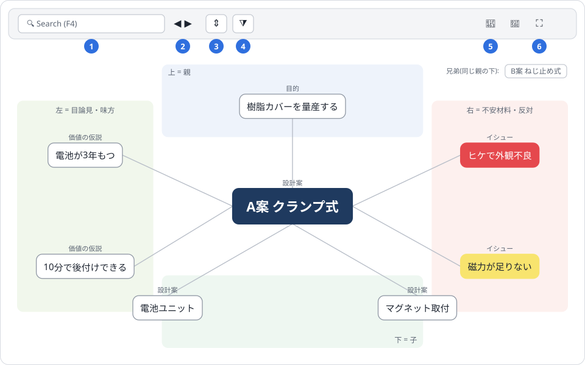

| 番号 | 名前 | 使う場面 |
| --- | --- | --- |
| 1 | Search(F4) | ノートの名前で探して、真ん中に出す |
| 2 | ◀ ▶(戻る・進む) | 前に見ていたノートへ戻る(7章) |
| 3 | Expanded view | 子の子まで出す(6章) |
| 4 | Views and lenses(漏斗の形) | ふだんの Compass と、何段も開く Mind Map の切り替え(6章) |
| 5 | Footprints(足あと) | たどってきたノートの一覧 |
| 6 | Maximize | K-Plex を画面いっぱいに広げる。もう一度押すと戻る |

右上の小さな四角は「兄弟」です。真ん中と同じ親を持つノート(例: 同じ目的の下の、ほかの成果物候補)が並びます。

## 2. 開く・中心を移す

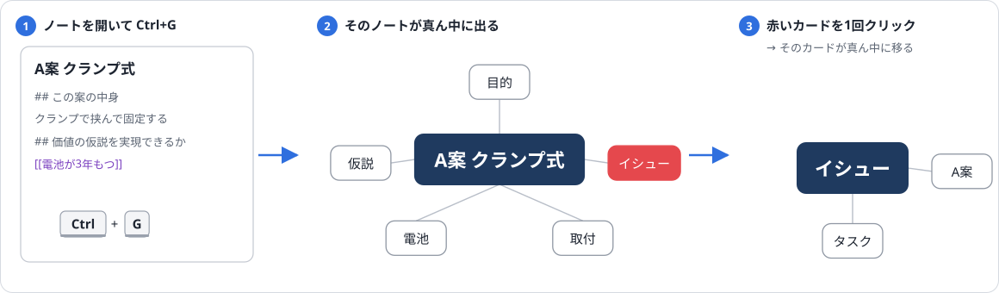

1. 見たいノートを開いて **Ctrl+G**。そのノートが真ん中に出ます。本文を右クリック →「K-Plex で見る」でも同じです。
2. カードを **1回クリック** すると、そのカードが真ん中に移ります。これを繰り返して、つながりをたどります。
3. カードを **ダブルクリック** すると、そのノートが開きます(書くときはこちらで)。
4. 閉じるときは、ふつうのタブと同じく × で閉じます。

## 3. 上下左右の意味

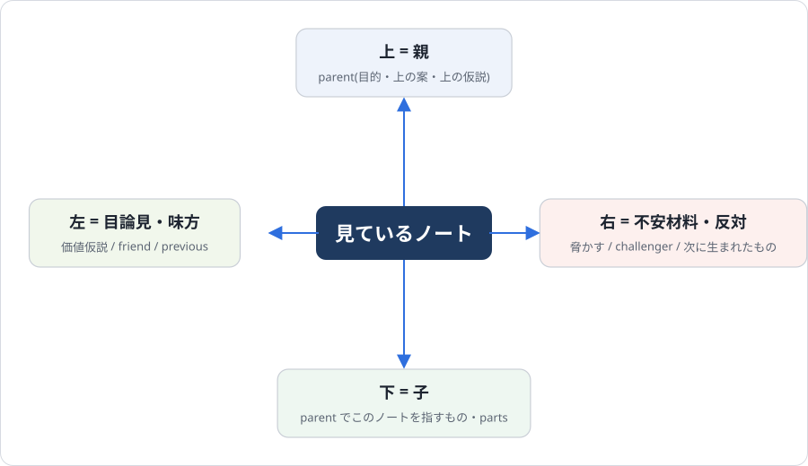

向きの意味は、どのノートを真ん中にしても同じです。

| 向き | 意味 | 出るもの |
| --- | --- | --- |
| 上 | 親 | 属性 parent に書いたもの(目的、上の案、上の仮説) |
| 下 | 子 | parent でこのノートを指しているもの。ノードの parts |
| 左 | 目論見・味方 | 設計案の **価値仮説**(この案で実現したい仮説)、関係(friend)、生んだもと(previous) |
| 右 | 不安材料・反対 | 設計案を **脅かす** イシュー、反論(challenger)、このノートから生まれた次のイシュー |

覚え方は1つだけです。**左はうれしいこと、右は心配なこと。**

### カードの色と点線

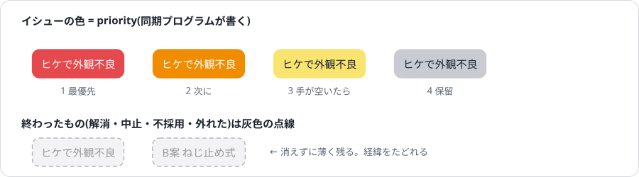

- イシューのカードは priority で色が変わります(1 赤、2 橙、3 黄、4 灰)。priority は同期プログラムが書くので、同期の前は白いままのことがあります。
- 終わったもの(解消・中止・不採用・外れた)は、灰色の点線で薄く出ます。消えないので、経緯をあとからたどれます。

## 4. つなぎ方

K-Plex の上下左右は、ノートの属性欄に書いたつながりで決まります。つながりを入れるやり方は2つです。

### キーで作ると、自動でつながる

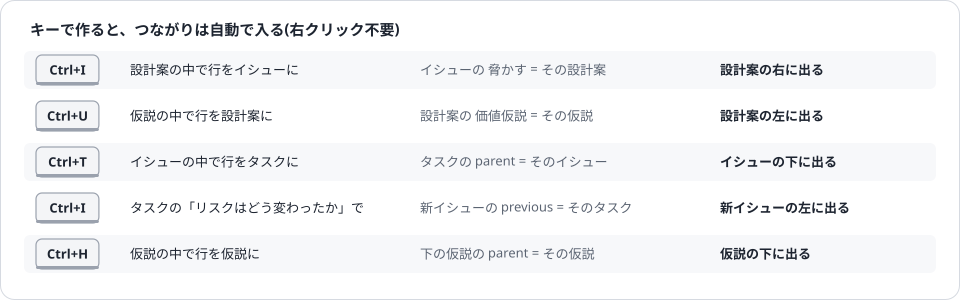

ふだんはこれで十分です。行の上でキーを押すと、新しいノートができて、つながりも入ります。

### あとからつなぐ: 右クリック

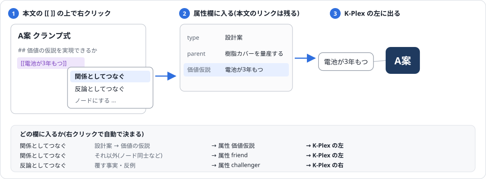

すでにあるノートをつなぐときに使います。

1. 本文に、つなぎたいノートを `[[ ]]` で書きます。
2. その `[[ ]]` の上で右クリック → **「関係としてつなぐ」** か **「反論としてつなぐ」**。
3. 属性欄に入り、K-Plex の左か右に出ます。本文のリンクはそのまま残ります。

| メニュー | どんなとき | 入る属性 | K-Plex |
| --- | --- | --- | --- |
| 関係としてつなぐ | 設計案に、実現したい価値の仮説をつなぐ | 価値仮説 | 左 |
| 関係としてつなぐ | ノード同士など、それ以外の関係 | friend | 左 |
| 反論としてつなぐ | このノートを覆す事実・反例をつなぐ | challenger | 右 |

- 「関係としてつなぐ」は、設計案の中で仮説をつなぐときだけ自動で 価値仮説 に入れます。使い分けを覚える必要はありません。
- イシューの **脅かす** は、設計案の中で Ctrl+I を押せば自動で入ります。手で書くときは、イシューの属性欄の 脅かす に `[[設計案]]` を書きます。
- つながりは、いつも**自分のノートにだけ**書きます。他の人のノートは書き換えません。

### 反論(challenger)の使いどころ

仮説や設計案を覆しそうな事実が出たら、それを「反論としてつなぐ」でつなぎます。K-Plex で右にカードがある仮説は、「この先の仕事を進めてよいか」を DR か定例で決める合図です。外れたとわかったら、仮説の status を「外れた」にします。

## 5. よく使う見方

### 目的を中心に

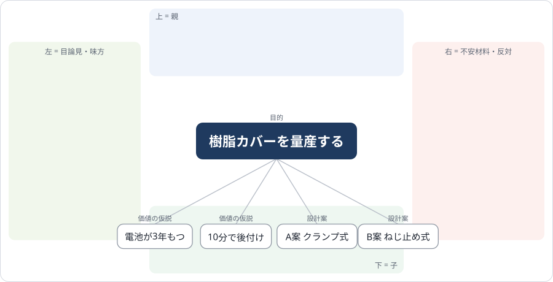

下に、価値の仮説と成果物の候補が並びます。仮説が3〜5個あるか、候補が2つ以上並んでいるかを見ます。

### 設計案を中心に(いちばん大事)

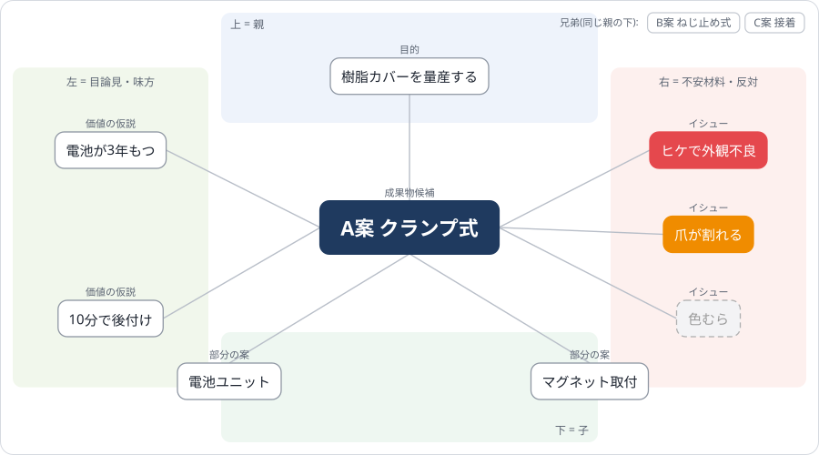

| 場所 | 見ること |
| --- | --- |
| 左(価値仮説) | この案で何を実現するつもりか。**空なら、目論見が書かれていない** |
| 右(脅かすイシュー) | この案の心配。**赤が多い案は危ない。1枚もない案は、心配が見えていないか、すでに解けている** |
| 下(部分の案) | 案の中身の分け方 |
| 右上(兄弟) | 比べる相手の案。クリックで行き来して、左右の埋まり方を比べる |

### 仮説を中心に

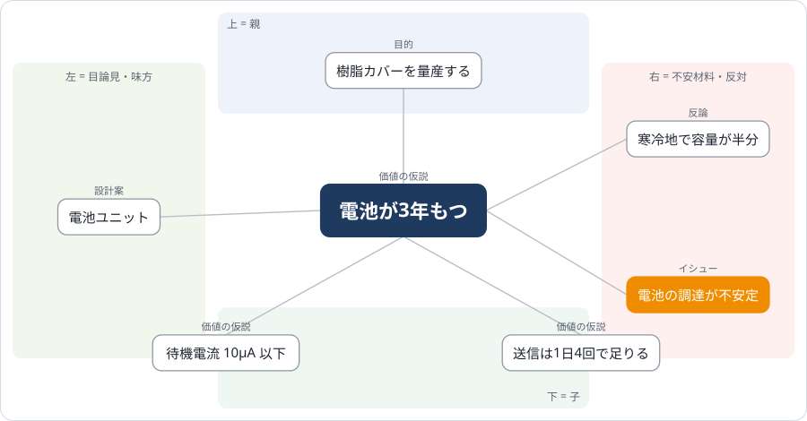

左に、この仮説を実現する設計案が並びます。**左が空の仮説は、まだどの案も引き受けていません。** 右に反論や、この仮説を直接脅かすイシューが出ます。下は仮説の木(前提を分けた仮説)です。

### イシューを中心に

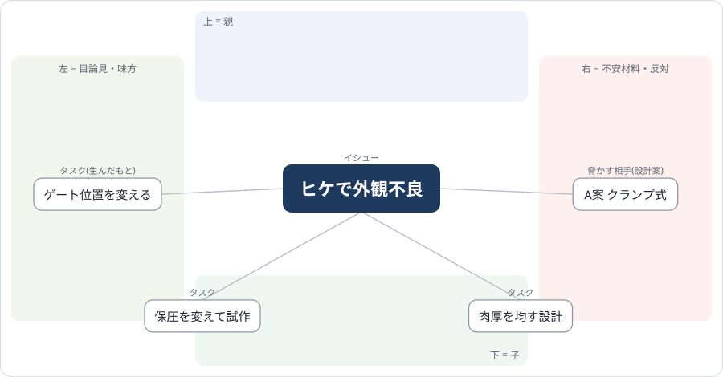

右に脅かしている設計案、下にリスクを減らすタスクが並びます。**下が空のイシューは、まだ誰も手をつけていません。** 左に「このイシューを生んだタスク」が出ていれば、対策から生まれた心配です。左をたどって同じような心配が続いていたら、案そのものを見直す合図です。

### ノードを中心に

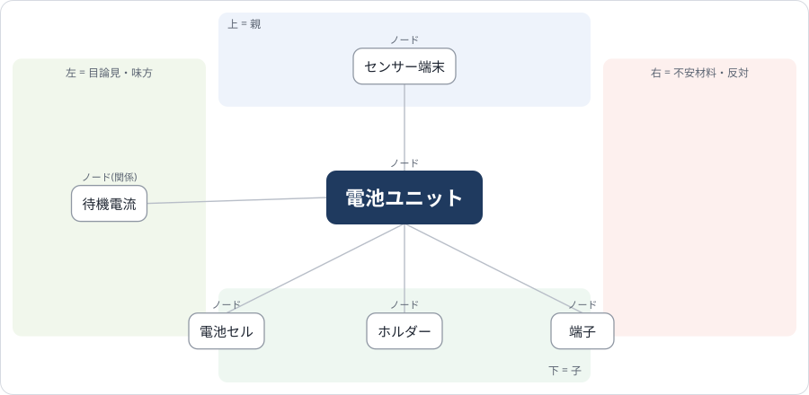

下に parts(部品・要素)、上にこのノードを含むもの、左に関係(friend)が並びます。末端が「組み立て」の値のままなら、原因をまだ分解できていません。

## 6. もっと先まで見る(多段階展開)

K-Plex には、1段より先を見るやり方が3つあります。

| やり方 | 見える範囲 | 向いている場面 |
| --- | --- | --- |
| クリックでたどる | 1段ずつ。上下左右すべて | ふだん。心配(右)や目論見(左)も見たいとき |
| Expanded view | 子の子まで(2段) | 案の中身を、もう1段だけのぞきたいとき |
| Mind Map | 親子の木を何段でも | 目的から下の全体の形をつかみたいとき |

### Expanded view(子の子まで出す)

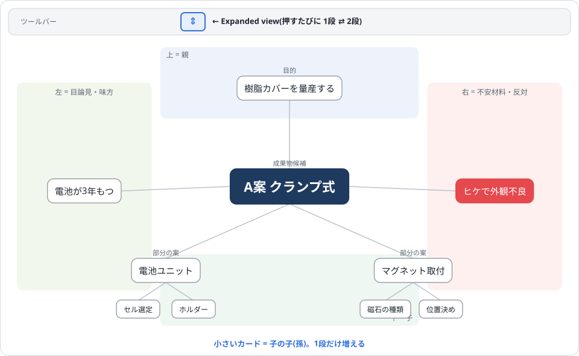

ツールバーの **Expanded view** ボタン(上下の矢印の形)を押すと、下のカードのさらに下(孫)が小さく出ます。もう一度押すと1段に戻ります。K-Plex は見やすさのため、この表示で出すのは2段までです。

### Mind Map(親子の木を何段でも開く)

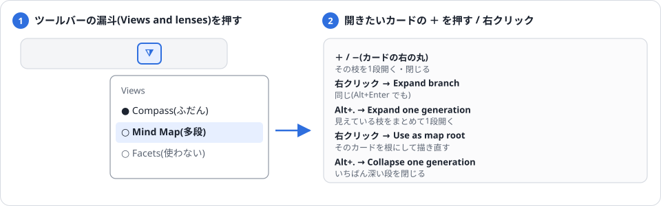

1. ツールバーの漏斗のボタン(Views and lenses)を押し、Views で **Mind Map** を選びます。
2. 今の中心が左端の「根」になり、子が右へ木の形に並びます。

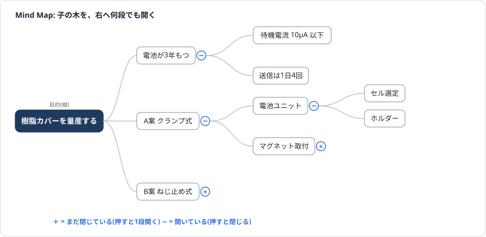

3. カードの右の **＋** を押すと、その枝が1段開きます。**−** で閉じます。右クリック →「Expand branch」や **Alt+Enter** でも同じです。
4. 全部の枝をまとめて1段ずつ開くときは、**Alt+.**(K-Plex のコマンド一覧)→「Expand one generation」。閉じるときは「Collapse one generation」。
5. 別のカードを根にしたいときは、そのカードを右クリック →「Use as map root」。

- Mind Map で枝として開けるのは**子(下)だけ**です。左右のつながり(価値仮説・脅かす・反論)は枝にならないので、イシューは設計案の木の中に出ません。心配を見るときは Compass に戻ります。
- 見終わったら、漏斗のボタンで **Compass** に戻しておきます。表示の選び方はタブごとに覚えられるので、戻さないと次も Mind Map で開きます。

## 7. たどった道を戻る

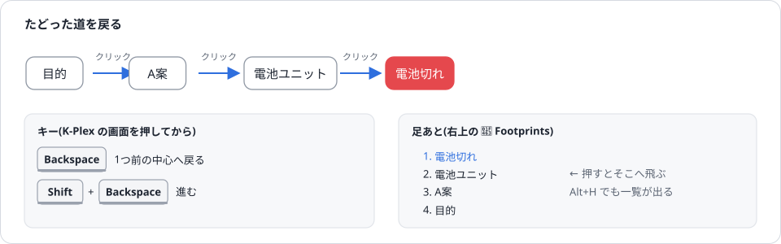

- **Backspace** で1つ前の中心に戻ります。**Shift+Backspace** で進みます。効かないときは、K-Plex の何もない所を1回クリックしてから押します。
- 右上の **Footprints**(足あと)を押すと、たどってきたノートの一覧が出ます。押すとそこへ飛びます。**Alt+H** でも一覧が出ます。

## 8. 見ながら作る

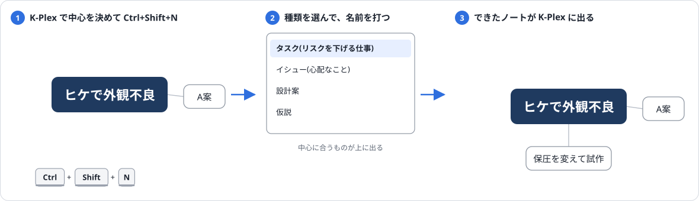

K-Plex を見ていて「この案のイシューが足りない」「このイシューのタスクがない」と気づいたら、その場で作れます。

1. 作りたいノートの親(例: イシュー)を K-Plex の真ん中にします。
2. **Ctrl+Shift+N** を押し、種類を選びます(真ん中の種類に合うものが上に出ます)。
3. 名前を打つと、つながりが入ったノートができて K-Plex に出ます。

**K-Plex の中では、次の2つを使いません。** つながりを書く向きが決まりと逆になり、別のノートを上書きしたことがあります。

- K-Plex の Ctrl+矢印(K-Plex 自身のノートの作り方)
- 真ん中のカードの中で書くこと(編集欄)

## 9. 困ったとき

| こんなとき | こうする |
| --- | --- |
| カードに色がつかない | K-Plex の設定でテーマが「開発ノート」になっているか見る。priority は同期プログラムが書くので、同期の前は色がつかない |
| 設計案の左右に何も出ない | 古いノートは、価値仮説が friend に、脅かすが parent に書かれている。システム管理者に `tools/migrate_v055.py` で書き換えてもらう |
| カードの名前に id がついて出る | Alt+. →「Toggle display names」で、名前の表示に切り替える |
| 書いたつながりが出てこない | 保存(Ctrl+S)して少し待つ。それでも出なければ Ctrl+P →「Rebuild K-Plex index」 |
| Backspace で戻れない | K-Plex の何もない所を1回クリックしてから押す |
| 開いたら Mind Map だった | 漏斗のボタンで Compass に戻す |
| K-Plex の中で間違えてノートを作った | そのノートを右クリック →「削除」。Ctrl+Shift+N で作り直す |
| 画面が散らかって見えない | ツールバーの Maximize で広げる。何もない所を右クリック →「Zen mode」でツールバーを隠せる |
